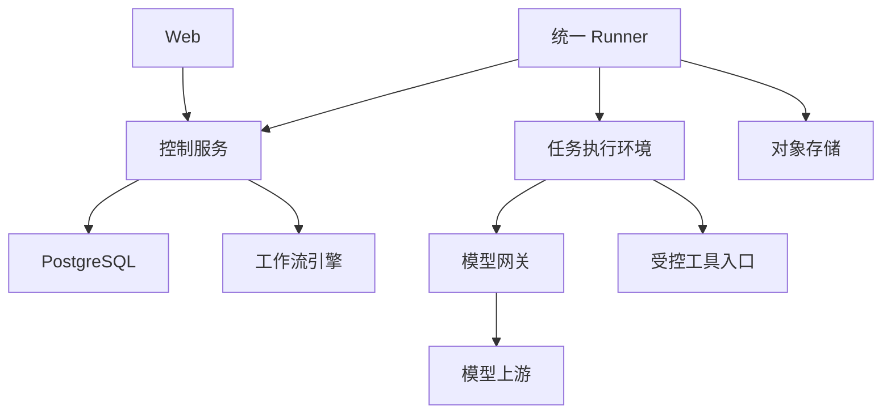

# 架构与可靠性约束

本文为目标设计；已提供独立沙箱 PoC 脚本，平台服务尚未实现。实现选择通过 ADR 固化。

## 模块关系

Runner 主动建立受认证连接或长轮询，避免要求本机和边缘开放入站端口。
控制服务提供业务任务 API；工作流引擎承担持久化执行协调，调度和故障状态只有一个权威写入路径。
平台任务记录承载业务身份、审计及查询视图；引擎和记录通过明确映射与对账恢复，避免互相独立重试。

## 职责

| 模块 | 职责 |
|---|---|
| 控制服务 | 用户授权、Agent 注册、节点身份、任务准入、调度与状态查询 |
| 工作流适配 | 持久化协调、等待、超时、受控重试；引擎二选一 |
| Runner | 节点心跳、槽位、租约、执行进程管理、日志、取消与结果上报 |
| 执行环境 | 固定基础镜像内运行动态代码、Shell 和浏览器，施加资源、文件和网络约束 |
| 模型网关 | 上游适配、额度池、限流、预算预留与用量记录 |
| 存储 | PostgreSQL 存元数据/关键状态；对象存储存允许上传的日志与产物 |
| Web | 提交、等待原因、进度、结果、费用估算、节点管理 |

## 最小数据契约

- AgentDefinition：agent_id、version、artifact_digest、runtime、input_schema、所需能力与副作用分类。
- Node：node_id、owner、pool、labels、capabilities、slots、last_seen、draining、凭证状态。
- Task：task_id、提交人、idempotency_key、input_hash、固定 Agent 版本、目标池、预算、状态。
- Attempt：task_id、attempt_id、单调递增 execution_epoch、node_id、lease_deadline、停止确认。
- Event：event_id、task_id、attempt_id、execution_epoch、sequence、timestamp、type、脱敏 payload。
- Artifact：task_id、attempt_id、URI 或本地引用、校验和、大小、数据访问级别。
- ModelUsage：task_id、attempt_id、request_id、quota_pool_id、token 计量、预留及核对状态。

提交幂等键在组织和提交人范围内唯一；服务端校验输入摘要。
任务接受响应必须发生在持久化事务成功后。
外部引擎启动通过事务 outbox 或等效可恢复机制协调，解决数据库提交与引擎调用之间的故障窗口。

## 状态与执行代次

主要状态：queued、running、waiting、cancel_requested、succeeded、failed、cancelled、needs_review。
waiting 必须包含原因，例如模型额度、重试退避或人工核对；界面展示实际等待原因。

租约标识当前执行权，execution_epoch 用于拒绝旧代次事件和结果。
租约过期不等于旧进程已经停止；必须按副作用类别决定是否允许重新分配。
仅控制面拒绝旧结果不能阻止旧进程产生外部副作用。
需要写入的工具应校验执行代次及操作幂等键；无法提供此保证时，结果未知须人工核对。

## 重试与取消

- 每个故障只有一个重试责任方。网关负责有限模型请求重试，编排层负责被声明为安全的任务重试。
- 记录重试次数、截止时间与累计成本，防止多层重试放大。
- 不承诺外部操作 exactly-once；使用幂等、去重与结果对账。
- 取消先持久化请求，再通知 Runner 停止进程与子进程，确认停止后进入 cancelled。
- 无法确认停止时保持取消中并标注失联，不伪造成功；已发生的外部操作不会因取消自动回滚。

## 断网与权限

边缘节点失联后不再领取新任务。运行中的节点只能在有效授权范围内完成已批准的安全步骤。
每次新工具操作均校验授权期限；到期停止发起新操作并尽力终止正在执行的任务。
已发出的外部请求可能仍完成，重连后必须核对，不将“授权过期”当成副作用撤回。

节点注册采用短期引导凭证交换独立节点凭证，支持吊销。
任务凭证限定任务、资源、动作与期限；模型上游长期密钥保留在网关。
工作目录白名单必须由 OS、挂载或沙箱强制执行，不能仅靠提示词和路径字符串检查。
容器避免特权模式、Docker socket 和宿主敏感目录挂载。
非受管本机不视为可信节点，不能接收平台密钥或其他用户的敏感任务。
日志在上传前脱敏；原始边缘数据、工作区与产物分别定义上传策略。

## 模型额度和费用

Agent 槽位与 LLM 并发分别控制。多个 API Key 若共享供应商额度，必须映射同一 quota_pool_id。
明确限流是全局还是进程级，多副本不能将配额简单复制。
发起请求前预留预算，结束后按实际用量结算；流式中断或账单未知时保留待核对记录。
硬预算需要可界定的最大输出、预留策略及统一执行路径；无法严格保证时 UI 必须显示为软限制。
共享额度存储不可用时，默认暂停新模型请求并显示原因。

## 待决事项

1. 控制服务与 Runner 的实现语言及本机首个目标 OS。
2. Hatchet 或 Temporal 的同负载 PoC 结果及接入契约。
3. 单一 Agent Runtime 与模型网关的选型。
4. Runner 传输协议、鉴权方案与版本兼容规则。
5. 容器及本机权限强制机制、开发部署方式。
6. 日志、产物保留期限以及用户删除流程。

## 动态执行边界

OpenSandbox 是首轮 PoC 基线，见 ADR 0001。Runner 调用受管沙箱管理面，Agent 工具仅访问授权任务沙箱。
不向任务沙箱注入平台长期凭证；不可信 Agent 程序本身也需隔离。
沙箱、浏览器会话与工作区绑定任务执行代次。模型检查点恢复不代表浏览器外部动作可重放。
SDK 客户端关闭与远端沙箱删除是独立操作；回收失败保留待核对状态，并通过 TTL 和孤儿扫描补偿。
